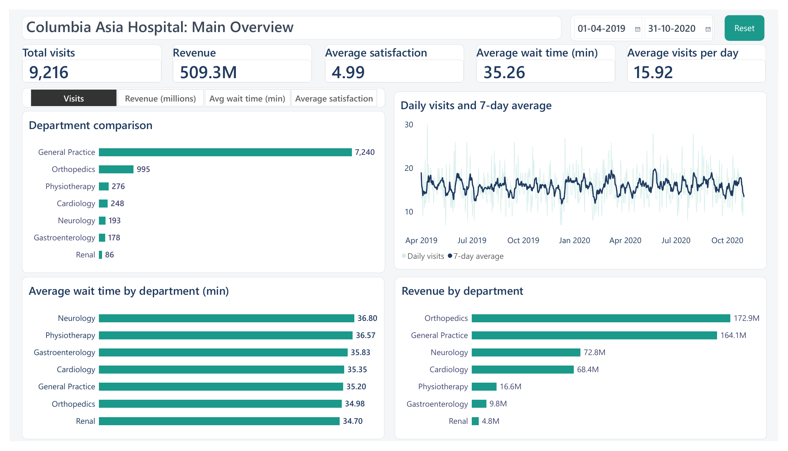
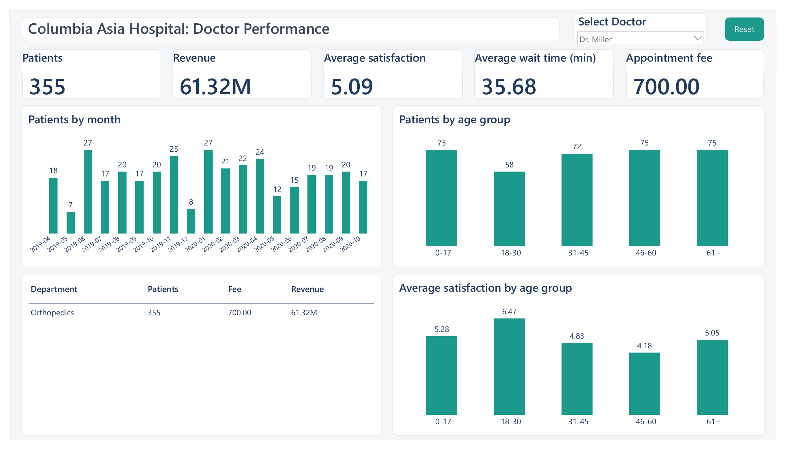
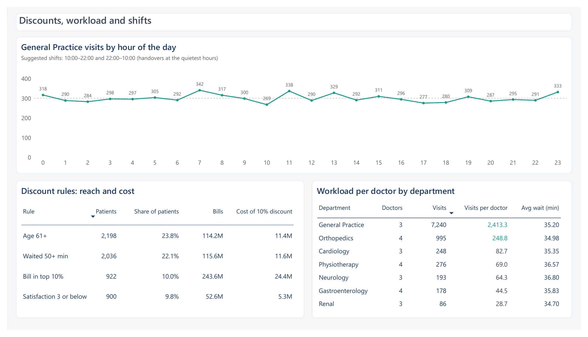

# Columbia Asia Hospital Analysis

Power BI and MySQL analysis of 9,216 hospital visits: where patients wait, which doctors and departments carry the load, and where to hire, offer discounts and set shifts.



## The problem
A hospital wants to know how it is running. Patients wait about 35 minutes on average, one doctor sees most of the patients, and management has a budget for 2 to 3 new doctors and for discounts. I analysed the visit data, built a report for three kinds of users (hospital, doctor, patient) and wrote down what I would do.

This is a case-study dataset, not real company data.

## What I did
1. Loaded two files into MySQL, joined them on `patient_id` and checked row counts, duplicates and totals.
2. Joined the same files in Power Query and built a Power BI report with 8 pages.
3. Checked that MySQL and Power BI give the same numbers (9,216 rows, revenue 509,309,117, average wait 35.26).
4. Answered the harder questions in SQL (window functions, CTEs) and in the report.
5. Wrote the findings and recommendations.

## Dashboard
Each tab is made for one user, with its own slicer and a Reset button.

| Hospital overview | Doctor performance |
|---|---|
|  |  |

The [Patients tab](screenshots/dashboard_patients.png) compares one patient with the department and hospital averages. All 8 report pages are in [`powerbi/columbia_asia_report.pdf`](powerbi/columbia_asia_report.pdf), and the full report is in [`powerbi/columbia_asia_dashboard.pbix`](powerbi/columbia_asia_dashboard.pbix) (open it with Power BI Desktop).



## Key findings
- **General Practice carries the hospital.** It has 7,240 of 9,216 visits (78.6%) with 3 doctors, and Dr. Smith alone has 5,986 patients (65%).
- **Orthopedics earns the most.** 172.9M of revenue (34.0%) from 995 visits, just ahead of General Practice (164.1M, 32.2%).
- **Waiting time is the same everywhere.** Neurology is longest at 36.80 minutes and Renal shortest at 34.70. The hospital-wide 35 minutes is the problem, not one department.
- **Satisfaction does not follow wait time.** Scores by wait band are 5.26, 4.91, 4.80, 5.04 and 4.94. Patients aged 61+ are the least satisfied (4.80) and the biggest group (2,198 visits).
- **No gap by race or gender** on wait, satisfaction, bill or specialist referral.
- **Visits are steady.** 431 to 530 a month, with no clear season.

## Recommendations
- **Hire 3 doctors:** 2 in General Practice and 1 in Orthopedics. General Practice has 2,413 visits per doctor.
- **Run General Practice in two shifts:** 10:00 to 22:00 and 22:00 to 10:00. Visits are nearly flat through the day, so the shifts get 3,573 and 3,667 visits.
- **Start with two discounts:** patients who waited 50+ minutes (2,036 patients, 11.6M cost at 10%) and patients aged 61+ (2,198 patients, 11.4M). Waited 50+, satisfaction 3 or below and age 61+ together would reach 51.7% of patients, which is too many.

The full reasoning is in [`docs/findings.md`](docs/findings.md).

## SQL
Seven queries in [`sql/02_analysis_queries.sql`](sql/02_analysis_queries.sql):
- Top 5 doctors by revenue among doctors with fewer patients than average
- Departments where average wait fell three months in a row (`LAG`)
- Male to female patient ratio per doctor, ranked (`RANK`)
- Average satisfaction per doctor
- Race mix and a diversity score per doctor
- Male to female bill ratio per department
- A what-if update on a copy table, so the original data stays untouched

## Tech stack

| Tool | Used for |
|---|---|
| MySQL 8.0 | Loading, joining, checks, analysis queries |
| Power BI Desktop | Data model, DAX measures, 8-page report |
| Power Query (M) | Join, age groups, wait bands |
| DAX | 36 measures, date table, field parameter, discount rules table |

## Data and limits
- The data is a case-study dataset of 9,216 visits (1 April 2019 to 30 October 2020), 22 doctors and 7 departments, one visit per patient. The report file has the data loaded in it. The two raw CSV files are not in this repo. [`docs/data_dictionary.md`](docs/data_dictionary.md) lists every column.
- The report opens and works as it is. The Refresh button will not work on another computer, because the source files were on my laptop.
- Revenue is the sum of bills. There is no cost data, so I cannot say if the hospital is profitable.
- Only 2,517 visits (27.3%) have a satisfaction score, so satisfaction results rest on a smaller group.
- Each patient visits once, so repeat visits cannot be studied.

## Repo structure
```
columbia-asia-hospital-analysis/
├── sql/
│   ├── 01_setup.sql              create tables, load CSVs, view, checks
│   └── 02_analysis_queries.sql   analysis queries
├── powerbi/
│   ├── columbia_asia_dashboard.pbix  the Power BI report
│   ├── measures.md               DAX measures and Power Query code
│   ├── columbia_asia_report.pdf  all 8 report pages
│   └── columbia_asia_theme.json  colours and fonts
├── screenshots/                  dashboard, report pages, SQL outputs
└── docs/
    ├── data_dictionary.md
    └── findings.md
```

## Run it yourself
**Power BI:** download `powerbi/columbia_asia_dashboard.pbix` and open it in Power BI Desktop (Windows).

**SQL:** you need MySQL 8.0 and the two CSV files with the columns in the data dictionary. Change the two file paths in `sql/01_setup.sql`, run it, then run `sql/02_analysis_queries.sql`.

## Built by
Aditya Jadhav, data analyst. [GitHub](https://github.com/theadityajadhav) · corp.adi07@gmail.com
